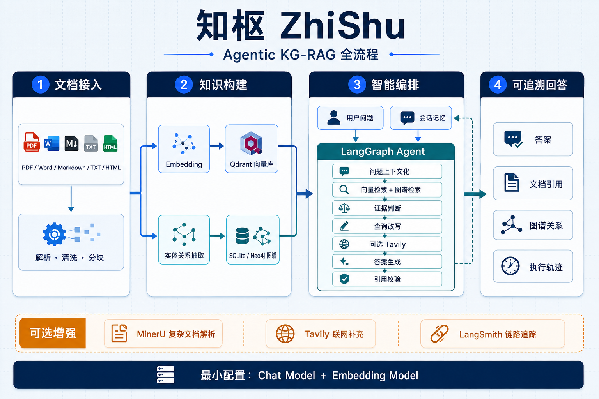

# 知枢 ZhiShu

知枢是一个面向自有文档的通用 Agentic KG-RAG 系统。用户可以建立多个知识空间，批量
导入 PDF、Word、Markdown、TXT 或 HTML；系统完成解析、向量索引、知识图谱抽取、混合
检索、带引用回答和持久会话记忆。它是独立的软件系统，不依赖论文实验或固定数据集。



## 已实现能力

- 多知识空间隔离，支持创建、重命名、级联删除。
- 批量文档导入；单个失败不影响同批其他文件。
- 内置 PDF、DOCX、Markdown/MDX、TXT、HTML 解析；MinerU 为可选增强。
- 本地 Qdrant 向量检索；SQLite 图存储开箱即用，可切换 Neo4j。
- LangGraph 编排问题上下文化、路由、混合检索、证据判断、查询改写、可选 Tavily、
  回答生成和引用校验。
- 按会话持久化消息；256K 模型窗口策略、220K 会话预算和自动滚动摘要。
- 文档删除、重建、后台任务、图谱子图可视化与运行状态面板。
- LangSmith 可选追踪；没有 Tavily、MinerU、LangSmith 或 Neo4j 时主链路仍可运行。

## 最小配置

要求 Python 3.11 或 3.12、[uv](https://docs.astral.sh/uv/)，以及一组 OpenAI 兼容的聊天
模型和 Embedding 模型。复制配置文件：

```bash
git clone https://github.com/yunmengovo/ZhiShu.git
cd ZhiShu
cp .env.example .env
```

最少填这六项：

```dotenv
CHAT_MODEL=your-chat-model
CHAT_BASE_URL=https://your-chat-endpoint/v1
CHAT_API_KEY=your-chat-api-key

EMBEDDING_MODEL=your-embedding-model
EMBEDDING_BASE_URL=https://your-embedding-endpoint/v1
EMBEDDING_API_KEY=your-embedding-api-key
```

模型地址、密钥、端口和存储位置属于部署配置，保存在 `.env`；分块大小、Top K、重试、
上下文预算、任务并发等运行策略统一定义在
[`runtime_config.py`](src/agentic_kg_rag/runtime_config.py)，不再混入 `.env`。

## 安装与启动

按顺序执行：

```bash
# 在克隆后的 ZhiShu 项目根目录执行
uv sync
uv run kg-rag-api
```

另开终端：

```bash
# 先进入同一个 ZhiShu 项目根目录
uv run kg-rag-ui
```

打开 `http://127.0.0.1:7860`。API 文档位于 `http://127.0.0.1:8000/docs`。

## 推荐使用流程

1. 在“知识空间”中新建或选择一个空间。
2. 一次拖入多份文件；默认勾选“上传后立即建立向量索引”。
3. 需要关系推理时，对文档执行“抽取知识图谱”，或导入时勾选自动抽取。
4. 在图谱画布中按文档或关键词检查实体关系。
5. 进入“智能问答”，选择知识空间与可选文档范围后提问。
6. 在右侧检查执行轨迹、文档证据、网页证据、图谱关系和引用校验结果。

复杂 PDF 可勾选 MinerU，但需要 `MINERU_TOKEN`；时效问题在本地证据不足时可由 Tavily
补充，但需要 `TAVILY_API_KEY`。这些都不是基础 KG-RAG 的必要条件。

## 可选 Neo4j

本机不安装 Neo4j 也能使用 SQLite 图存储和系统内图谱画布。部署到有 Docker 的服务器时：

先在 `.env` 中将 `NEO4J_PASSWORD` 设置为自己的强密码，不要使用示例占位密码。

```bash
docker compose --env-file .env -f compose.neo4j.yaml up -d
```

然后设置 `GRAPH_MODE=neo4j`、填入 Neo4j 连接配置并重启 API。Neo4j Browser 默认在
`http://127.0.0.1:7474`。

## 检查

```bash
uv run ruff check .
uv run pytest -q
```

完整架构、数据流、接口示例、配置说明、故障降级与部署建议见
[`docs/TECHNICAL_REPORT.md`](docs/TECHNICAL_REPORT.md)。

## 仓库与本地数据

仓库包含源代码、测试、技术文档、`uv.lock` 和无真实密钥的 `.env.example`。
`.env` 及其本地变体、上传文档、向量索引、图谱数据库、会话记录、日志和缓存均不提交。
`data/` 仅保留目录占位文件；新环境需要自行配置密钥并导入资料。
