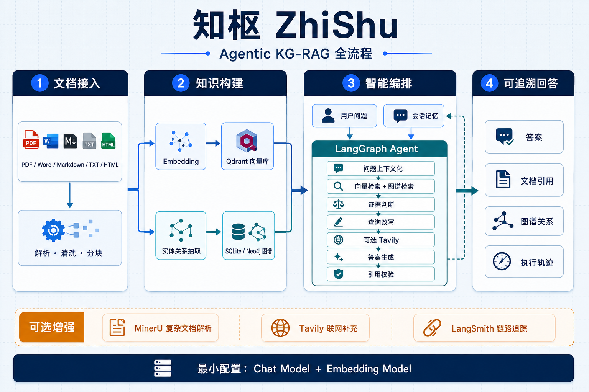

# 知枢 ZhiShu 技术报告

版本：0.2.0  
性质：独立的通用文档智能系统  
技术主题：RAG、知识图谱问答（KGQA）、Agentic RAG、会话记忆与可观测性

## 1. 系统目标

知枢把用户自己的非结构化资料转换为可检索、可关联、可追溯的知识空间。系统不绑定固定
数据集或业务领域，完整闭环如下：

```text
创建知识空间 -> 批量导入文档 -> 解析与分块
  -> 向量索引 + 知识图谱抽取
  -> Agent 判断检索策略
  -> 融合文档、图谱与可选网页证据
  -> 生成并校验带引用答案
  -> 保存会话，超过预算时压缩旧消息
```

基础系统只要求聊天模型和 Embedding 模型。Qdrant 使用本地嵌入模式，图谱默认使用
SQLite，无需 Docker 或额外数据库即可运行 KG-RAG。MinerU、Tavily、LangSmith、Neo4j
均为增强项。

## 2. 总体架构



```text
Gradio Web UI
   |
FastAPI
   |-- KnowledgeBase / Workspace：空间与文档生命周期
   |-- Ingestion：格式解析、标准化、分块、去重
   |-- RAG：Embedding、Qdrant、证据化回答
   |-- KnowledgeGraph：LLM 抽取、SQLite/Neo4j、子图
   |-- Agent：LangGraph 状态机、检索纠正、引用校验
   |-- Memory：SQLite 会话、上下文化、滚动摘要
   |-- Jobs：持久任务记录 + 线程池
   `-- Integrations：MinerU / Tavily / LangSmith
```

离线链路：

```text
PDF/DOCX/MD/TXT/HTML -> Parser -> Block -> Chunk
                                         |-> Embedding -> Qdrant
                                         `-> 实体关系抽取 -> SQLite / Neo4j
```

在线链路：

```text
问题 + 会话上下文 -> 问题上下文化 -> 路由
  -> 向量候选 + 图谱关系 -> RRF 融合与图谱加权
  -> 证据判断
     |-> 相关：回答
     |-> 不相关且可重试：改写查询后重检索
     `-> 本地不足 + 时效问题 + Tavily 可用：网页搜索
  -> 引用编号校验 -> 回答、证据、图谱与执行轨迹
```

## 3. 技术栈

| 层 | 技术 | 职责 |
|---|---|---|
| UI | Gradio | 知识空间、批量导入、资产状态、图谱 SVG、会话问答 |
| API | FastAPI + Pydantic | 类型化接口、校验、依赖注入、HTTP 错误 |
| Agent | LangGraph | 有状态节点编排、条件分支、重试与轨迹 |
| 模型 | LangChain OpenAI-compatible | Chat、Embedding、知识抽取 |
| 向量库 | Qdrant Client | 本地向量、范围过滤、相似度召回 |
| 图存储 | SQLite / Neo4j | 实体、关系、mention 和来源 chunk |
| 元数据 | SQLite | 知识空间、会话、摘要、任务状态 |
| 可选服务 | MinerU / Tavily / LangSmith | 增强解析、网页补充、链路观测 |
| 工程 | uv / Ruff / Pytest | 依赖锁定、静态检查、自动测试 |

## 4. 配置设计

### 4.1 `.env`：部署和密钥

`.env` 只放会随部署改变的内容：模型名、Base URL、API Key、端口、数据路径，以及可选
Tavily、LangSmith、MinerU、Neo4j 凭据。它已被 `.gitignore` 排除，不能提交真实密钥。

最低配置为：

```dotenv
CHAT_MODEL=...
CHAT_BASE_URL=.../v1
CHAT_API_KEY=...
EMBEDDING_MODEL=...
EMBEDDING_BASE_URL=.../v1
EMBEDDING_API_KEY=...
```

### 4.2 `runtime_config.py`：行为策略

运行策略由冻结的 Pydantic class 分类管理：

- `IngestionRuntimeConfig`：30 MB、800 字符分块、120 重叠、50 文件/批；
- `RetrievalRuntimeConfig`：向量/图谱/网页候选、RRF 常数；
- `KnowledgeGraphRuntimeConfig`：图谱抽取批次、可视化上限；
- `AgentRuntimeConfig`：查询改写次数、引用校验、时效关键词；
- `MemoryRuntimeConfig`：256K 总窗口、220K 会话预算、12 条近期消息、4K 摘要；
- `JobRuntimeConfig`：4 个线程、500 条任务历史；
- `MinerURuntimeConfig`：模型版本、轮询间隔、超时。

切换服务或路径改 `.env`；修改产品行为改 `runtime_config.py` 并重启服务。

## 5. 文档接入与批量处理

| 格式 | 默认解析器 | 主要保留内容 |
|---|---|---|
| PDF | PyMuPDF | 页码、文本块、元数据 |
| DOCX | python-docx | 标题、段落、列表、表格 |
| Markdown/MDX | 内置解析 | 标题层级、代码块、frontmatter |
| TXT | 内置解析 | 段落与标题推断 |
| HTML | BeautifulSoup + markdownify | 标题与正文，过滤脚本 |
| 扫描/复杂 PDF | MinerU，可选 | 公式、表格、版面转 Markdown |

文件使用 SHA-256 去重。同一内容放进不同知识空间会生成不同 `document_id`；同一空间重复
上传且处理配置未改变时直接返回已有结果。批量上传逐文件捕获错误，不会因一个损坏文件
回滚其他成功文件。

```bash
curl -X POST http://127.0.0.1:8000/documents/batch \
  -F 'knowledge_base_id=kb-default' \
  -F 'files=@/path/a.pdf' \
  -F 'files=@/path/b.docx'
```

MinerU 增强路径采用批次 API：申请签名地址、PUT 文件、轮询结果、下载 zip、读取
`full.md`。未配置 Token 时只禁用该入口，不影响内置解析。

```bash
curl -X POST http://127.0.0.1:8000/integrations/mineru/ingest \
  -F 'knowledge_base_id=kb-default' -F 'file=@/path/complex.pdf'
```

## 6. 知识空间与文档生命周期

知识空间目录位于 `data/catalog.db`。`kb-default` 始终存在且不可删除；其他空间支持创建、
重命名和级联删除。

```bash
curl -X POST http://127.0.0.1:8000/knowledge-bases \
  -H 'Content-Type: application/json' \
  -d '{"name":"产品资料","description":"产品文档集合"}'

curl 'http://127.0.0.1:8000/workspace/assets?knowledge_base_id=<kb-id>'
curl -X DELETE http://127.0.0.1:8000/documents/<document-id>
```

资产接口汇总解析状态、chunk 数、向量数、实体数和关系数。删除文档会清理原文件、标准化
JSON、Qdrant 向量及图谱来源；外部存储临时失败时继续其他清理并返回 warning。

完整重建既可同步执行，也可提交持久化后台任务：

```bash
curl -X POST http://127.0.0.1:8000/jobs/documents/<document-id>/rebuild \
  -H 'Content-Type: application/json' \
  -d '{"reparse":true,"rebuild_vector":true,"rebuild_graph":true}'
curl http://127.0.0.1:8000/jobs
```

## 7. 向量 RAG

Qdrant payload 保存 `knowledge_base_id`、`document_id`、`chunk_id`、文件名、标题、正文、
章节、页码、顺序和自定义元数据。问答可按知识空间或显式文档列表过滤；二者同时存在时
会检查文档归属，阻止跨空间检索。

```bash
curl -X POST http://127.0.0.1:8000/rag/ask \
  -H 'Content-Type: application/json' \
  -d '{"question":"系统如何保存会话？","knowledge_base_id":"kb-default","top_k":5}'
```

回答的 `[1]`、`[2]` 对应响应 `evidence` 的 rank，并返回原文、文件、章节和页码。

## 8. 知识图谱与 KGQA

图谱抽取器把 chunk 当成不可信数据，只从明确文本中抽取实体和关系。每条关系保存
`document_id` 与 `chunk_id`，所以图谱结论可回溯原文。默认 SQLite 会进行 Unicode、空白
和大小写归一化；重复抽取采用文档替换语义并清理孤立实体。

```bash
curl -X POST http://127.0.0.1:8000/graph/extract/<document-id>
curl -X POST http://127.0.0.1:8000/graph/search \
  -H 'Content-Type: application/json' \
  -d '{"query":"Agent 与 Retriever 的关系","document_ids":["<document-id>"]}'
curl -X POST http://127.0.0.1:8000/graph/subgraph \
  -H 'Content-Type: application/json' \
  -d '{"query":"Retriever","document_ids":[],"limit":80}'
```

前端将子图画成带方向、关系文字和实体类型配色的 SVG，可按文档或关键词过滤。Neo4j
模式还提供 `Document`、`Chunk`、`Entity` 节点及 `HAS_CHUNK`、`MENTIONED_IN`、
`RELATES_TO` 关系，适合服务器端图遍历。

## 9. Agentic KG-RAG

LangGraph 的真实节点顺序/分支为：

1. `contextualize_question`：利用会话摘要和近期消息消解指代；
2. `route_question`：闲聊直接回答，事实问题进入检索；
3. `retrieve`：扩大向量候选池并并行语义上组合图谱结果；
4. `grade_evidence`：判断相关性，不苛求穷尽式完整；
5. `rewrite_query`：保留实体与意图后重检索；
6. `web_search`：仅本地不足、问题具时效性且 Tavily 可用时运行；
7. `generate_answer`：融合文档、图谱、网页和会话上下文；
8. `verify_citations`：删除不存在的引用编号，报告缺少编号；
9. `insufficient_answer`：所有路径无证据时明确停止。

向量候选按 chunk 去重，用 Reciprocal Rank Fusion 排序；支撑图谱命中关系的 chunk 获得
额外排名分。图谱关系使用 `[G1]`、`[G2]` 引用。

```bash
curl -X POST http://127.0.0.1:8000/agent/ask \
  -H 'Content-Type: application/json' \
  -d '{"question":"它和向量检索如何配合？","knowledge_base_id":"kb-default",\
       "session_id":"<session-id>","top_k":5}'
```

响应含 `route`、`final_query`、`retrieval_attempts`、`steps`、`evidence`、
`graph_relations`、`used_web_search`、`citations_valid` 和 `citation_warnings`。

## 10. 会话记忆

会话位于 `data/memory/conversations.db`。默认把 256,000 token 总窗口中的 220,000 分配
给会话记忆，余下 36,000 留给系统提示、证据、图谱和输出。超过预算时：保留最近 12 条
消息，把更早消息合并进滚动摘要，摘要限制约 4,000 token；模型压缩失败时不删除原消息，
当前问答仍继续并返回警告。

256K 是系统预算，不代表任意模型都支持 256K。部署时应确认实际模型窗口，必要时修改
`runtime_config.py`。

## 11. 可选服务与降级

| 服务 | 触发方式 | 不可用时 |
|---|---|---|
| MinerU | 用户主动勾选增强解析 | 使用默认解析器 |
| Tavily | 本地重试耗尽且问题有时效性 | 返回本地证据不足 |
| LangSmith | 开启 tracing 并配置 Key | 只失去远程 trace |
| Neo4j | `GRAPH_MODE=neo4j` | 可切回 SQLite；Agent 记录图谱降级 |

参考：[Tavily Python SDK](https://docs.tavily.com/documentation/quickstart)、
[MinerU API](https://mineru.net/apiManage/docs)。

## 12. 前端使用

“知识空间”页面支持空间管理、批量拖入、自动向量/图谱处理、可选 MinerU、资产状态、
文档删除/重建、图谱可视化和后台任务进度。“智能问答”页面先选择知识空间，再按需限定
具体文档；智能模式使用完整 Agent、KG 与记忆，基础 RAG 保留为简单固定链路。右栏显示
真实节点轨迹、证据、图谱关系、引用校验及记忆用量。

## 13. 数据目录与部署

```text
data/
  catalog.db                 # 知识空间
  jobs.db                    # 后台任务
  raw/<document_id>/         # 原文件与可选 MinerU Markdown
  processed/<document>.json  # Block/Chunk
  qdrant/                    # 本地向量库
  graph/knowledge.db         # SQLite 图谱
  memory/conversations.db    # 会话与摘要
  neo4j/                     # 可选 Neo4j 数据
```

运行数据与 `.env` 默认被 Git 忽略。使用 Neo4j：

```bash
docker compose --env-file .env -f compose.neo4j.yaml up -d
```

将 `GRAPH_MODE` 改为 `neo4j` 并重启 API。当前后台任务为单进程线程池；多副本生产环境应
替换为 Celery/RQ 等外部队列。

## 14. 启动、验证和排错

```bash
uv sync
uv run ruff check .
uv run pytest -q
uv run kg-rag-api
# 另开终端
uv run kg-rag-ui
```

健康检查：

```bash
curl http://127.0.0.1:8000/health
curl http://127.0.0.1:8000/rag/status
curl http://127.0.0.1:8000/graph/status
curl http://127.0.0.1:8000/integrations/status
```

常见问题：

- `503 上游模型服务暂时不可用`：检查模型地址、Key、模型名和供应商状态；
- Embedding 维度变化：更换集合名或清理旧集合后重建全部向量；
- UI 无法连接：确认 API 8000 端口和 `UI_API_BASE_URL`；
- 图谱为空：上传只生成 chunk，需执行“抽取知识图谱”；
- MinerU/Tavily 不工作：检查顶部“可选增强”状态和对应 Key；
- Neo4j 离线：设置 `GRAPH_MODE=local` 使用内置 SQLite。

## 15. 测试覆盖与边界

测试覆盖格式解析、去重、知识空间隔离、向量检索、图谱抽取/检索、Neo4j 降级、Agent
分支与改写、引用校验、会话压缩、MinerU zip、RRF、任务生命周期及 Gradio 关键函数。

当前不包含登录、多租户权限、分布式任务、昂贵的全局实体消歧。系统内 SVG 适合检查
中等规模子图；超大图建议用 Neo4j Browser 或专用图前端。这些边界不妨碍单机/单服务器
上的完整通用 Agentic KG-RAG 使用闭环。
